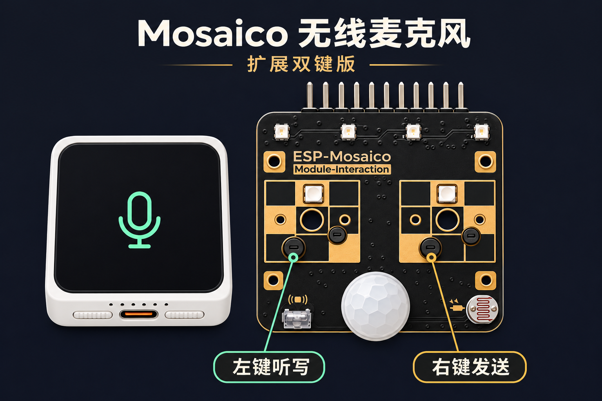

# Mosaico Mic

## 扩展双键版

`0.2.5-expansion` 基于 [jinhe1314 的 Wireless Mic](https://github.com/jinhe1314/esp-mosaico-wireless-mic/tree/3e4192564f09fa6a32e22cf39a72d45c65435b85) 公开源码修改。
插上官方多功能交互模块后，按住 `KEY_L` 听写，松手后等 Codex 显示转写文字，再按一次 `KEY_R` 发回车。
Mac 上配对 `Mosaico Mic`，在 Codex 选择该麦克风，并把「听写快捷键」设为 `F18`。
扩展板的按键位置以模块丝印为准。[乐鑫模块说明](https://docs.espressif.com/projects/esp-dev-kits/zh_CN/latest/esp32s31/esp-mosaico/user_guide_interact.html)

ESP32-S31 构建和 5 项本机测试已通过。扩展键触发听写和发送的完整流程仍待实机验证。
改动文件保留了原有许可证标记。[Apache 2.0 许可证文本](LICENSES/Apache-2.0.txt)

ESP-Mosaico / ESP32-S31 wireless microphone prototype for a Mac, using Classic
Bluetooth HFP Hands-Free (HF) and the board's ES8311 microphone. Independent app;
Snake source remains in the sibling project. Device Bluetooth name: **Mosaico Mic**.

## Microphone and touch controls

- ES8311 microphone -> I2S -> bounded PCM FIFO -> HFP HF -> Mac system input.
- mSBC uses 16 kHz mono signed 16-bit PCM; CVSD falls back to 8 kHz.
- No speaker playback. Select Mac speakers or another output for listening.
- No game, simulator, Wi-Fi receiver or desktop audio driver is needed.
- Touchscreen: hold-to-talk, Enter, Clear All, and a gear opening an ANSI keyboard setup page.
- Clear All sends Command+A then Backspace to the current Mac focus. Keep the
  cursor in the intended text field; this does not inspect or target an app.
- Physical BOOT button while running: hold for F18, double-click for Enter.
- Official Interaction module (left or right slot): hold `KEY_L` for F18 and
  release to finish dictation. Press `KEY_R` once to send Enter. This works
  after EEPROM detection, with the module's mechanical buttons.
- For Codex, bind the hold-to-dictate shortcut to F18, select Mosaico Mic as
  the microphone, and focus the composer. Wait for the transcript before
  pressing `KEY_R`. Other apps that need Fn can use the Mac helper.
- USB ESP-Iris remains the update link; retained Vibe Mode/partitions are preserved.
- Pairing uses SSP Just Works and remains discoverable while idle. Pair only in a
  trusted environment during prototype tests. No pairing record is auto-erased.

## Build and install

Use the workspace-pinned ESP-IDF commit
`7b9cc1ac79f865983f59bb8ff3ff43eb74ff1dbe` (6.2.0), target `esp32s31`.
From the workspace root, use its `idf-low-noise-build` runner to build this project,
then `python mosaico.py iris system-update --project projects/wireless_mic` with
an explicitly selected device. All board operations go through `mosaico.py`.
Do not use direct flash commands or erase the board.

The pinned IDF internal HFP codec uses legacy PCM callbacks. This is an explicit
prototype compatibility choice; an SDK upgrade must review its replacement API.
No third-party SBC codec is added. Dependencies come from the existing BSP/Iris.

## Mac acceptance

1. Pair **Mosaico Mic** in Bluetooth settings.
2. Choose **Mosaico Mic** under Sound > Input, keeping your normal sound output.
3. Record without a phone call. Confirm real speech and not a loopback/test tone.
4. Inspect firmware logs: `SCO ... codec=mSBC pcm_rate=16000` confirms negotiation;
   a WAV file's sample rate alone does not. CVSD must be reported as fallback.
5. Check microphone peak/clipping/read-error and FIFO underflow/overflow counters.
6. Test 30 minutes, stop/restart capture, application switching, sleep/wake,
   disconnect/reconnect, range and battery operation before claiming stability.

Initial test host: Apple M5 MacBook Pro (Mac17,2), macOS 27.0.1 (26A434).
BSP runtime reports board hardware V1.2; this is firmware-reported identification.

## Ownership

`main` starts retained recovery, microphone capture and HFP. `app_audio` owns codec,
worker and synchronized FIFO. `app_hfp` owns Bluetooth and consumes PCM via public
interfaces. Codec/transport errors are logged; startup failure leaves Recovery
reachable. No automatic NVS erase or hidden call/voice-assistant activation.

Build and test results belong in `docs/validation.md`. Pairing, compilation or
healthy boot alone does not establish usable Mac microphone interoperability.

## Mac helper v0.3.0

`tools/macos/build_settings.sh` builds the native settings application and runs
configuration, key-event and bounded-log tests. The settings window includes an
application version and read-only diagnostics. The default prefix is
Command+Option+Control+L, followed by 100 ms and an Fn hold until release.
macOS Accessibility/Input Monitoring authorization is required; rebuilding the
ad-hoc signed application can require reauthorization. This prototype's HID
mapping reads the paired board serial from a private local file; see
`tools/macos/README.md` for setup. This repository is a workspace application, not a standalone BSP
checkout: place it in `esp-mosaico-vibe/projects/wireless_mic` with the pinned
workspace dependencies present.
